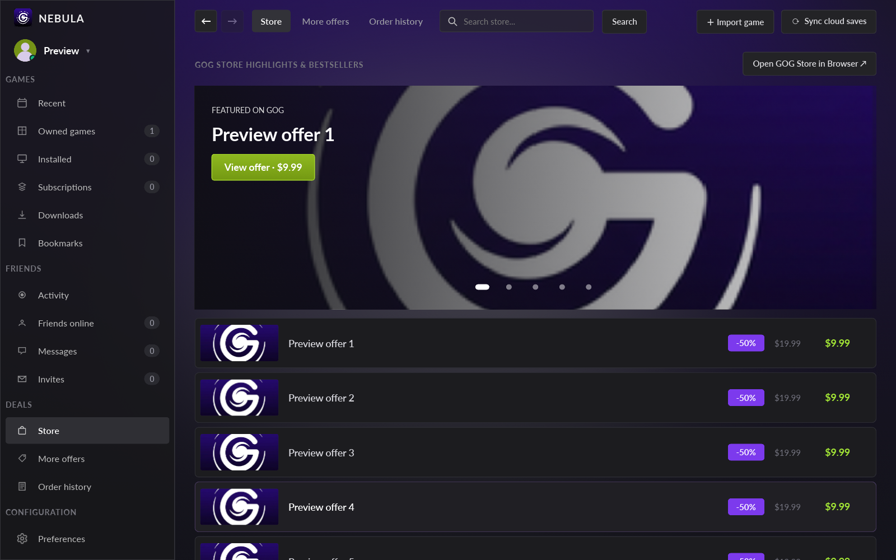

# Nebula

An unofficial GOG launcher for Linux, written in Rust with a [Slint](https://slint.dev) UI.
Library, store, installs and Windows games via Proton/Wine — in the spirit of GOG Galaxy.



> The screenshot is rendered offline with clearly labelled fixture data (`nebula --preview-page 9`).

## Features

| Area | Status |
|------|--------|
| GOG sign-in (embedded WebKitGTK window) | ✅ |
| Library, cover artwork, search, platform filter, bookmarks | ✅ |
| Store search, deals carousel, offer links | ✅ |
| Install native Linux builds | ✅ via `gogdl` |
| Install **Windows builds** and run them with Proton-GE / Proton / Wine, one prefix per game | ✅ (like Heroic) |
| Import existing installs, launch, remove entry (never deletes game files) | ✅ |
| Themes (Nebula Dark, Classic Galaxy, Cyberpunk Cyan), in-app glass effect | ✅ |
| Tray icon, single-instance, desktop entry | ✅ (GNOME needs an AppIndicator extension) |
| Cloud saves | ✅ GOG Cloud Storage sync (sync before launch & after exit, manual sync) |

## How installs work

Nebula asks GOG for a Linux build first; if the game has none (e.g. most titles), it
downloads the **Windows build** and launches it through the best runner it finds:

1. GE-Proton (newest first) → other Proton → Heroic's Wine → system Wine.
2. Runners are detected in `~/.steam/steam/compatibilitytools.d`, `~/.local/share/Steam`,
   `~/.config/heroic/tools/{proton,wine}` and `PATH`.
3. Each game gets its own prefix in `~/Games/Nebula/prefixes/<game id>`.
4. The launch target comes from the game's `goggame-<id>.info`. Game output is logged to
   `~/.cache/nebula/logs/<game id>.log`.

## Requirements

- Rust (stable) and the GTK/WebKitGTK development packages
- [`gogdl`](https://github.com/Heroic-Games-Launcher/heroic-gogdl) — found on `PATH`, via `NEBULA_GOGDL`,
  or from a Heroic install
- Wine or Proton (e.g. via Heroic or ProtonUp-Qt) for Windows games
- `zenity` for the install/progress dialogs
- GNOME: an AppIndicator/StatusNotifier extension for the tray icon

## Build and install

```bash
cargo test
cargo build --release
scripts/install-local.sh target/release/nebula   # installs to ~/.local/bin, adds desktop entry + icon
```

Then start **Nebula** from your app launcher. Restart it after reinstalling.

`nebula --preview-page N [--preview-no-glass]` renders a page offline to `/tmp/nebula-page-N.png`
and exits (pages 1, 9, 10, 12 and 20 use fixture data; no account or network needed).

## Data locations

- `~/.config/nebula/` — session, bookmarks, installed-game registry
- `~/Games/Nebula/` — games and Wine prefixes
- `~/.cache/nebula/` — artwork and game logs

## Credits

The client ID/secret in `src/auth.rs` is GOG Galaxy's public client pair, also used by other
open-source launchers; no personal credentials are stored in this repository.
Settings icon from [Lucide](https://lucide.dev) (license in `assets/icons/LICENSE-lucide`).
Nebula is not affiliated with or endorsed by GOG.
